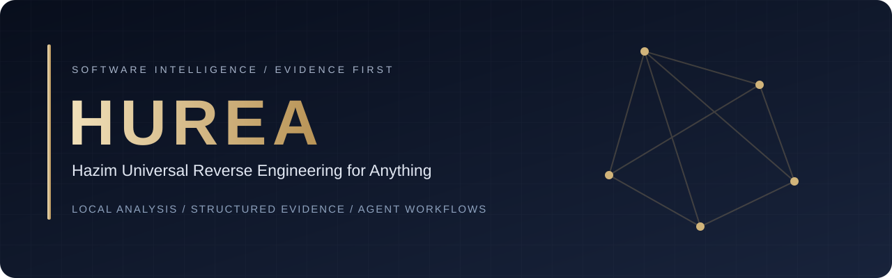
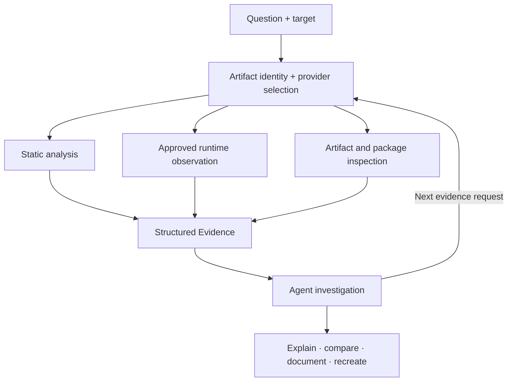

<div align="center">



# Understand the software. Follow the evidence.

**Hazim Universal Reverse Engineering for Anything**

A local reverse engineering toolkit that connects AI agents to binary analysis,
application inspection, controlled observation, and reproducible evidence.

[](LICENSE)
[](tsconfig.json)
[](package.json)
[](docs/mcp-contracts.md)
[](#how-hurea-works)

[Get started](#get-started) · [How it works](#how-hurea-works) · [Capabilities](#capabilities) · [Documentation](#documentation) · [العربية](README_ar.md)

</div>

---

HUREA gives your agent a structured way to investigate an application when source code alone is not enough—or is not available. It can inspect artifacts, decompile native functions through configured providers, connect findings across application layers, and return evidence explaining what was observed and what remains uncertain.

**Developed and maintained by Hazim Batwa.** HUREA brings together mobile package analysis, runtime observation, protocols, data flow, firmware inspection, and local analysis providers.

## Why HUREA

| Principle                                | What it means for your investigation                                                                                                           |
| :--------------------------------------- | :--------------------------------------------------------------------------------------------------------------------------------------------- |
| **One interface, multiple engines**      | CLI commands and MCP tools share application workflows rather than separate analysis implementations.                                          |
| **Evidence before conclusions**          | Results carry target identity, provider provenance, authority, limitations, and evidence references.                                           |
| **Local analysis**                       | HUREA does not require a hosted analysis service. Connecting an external AI client is a separate choice about where that client sends context. |
| **Explicit capabilities**                | Provider selection reports availability and target compatibility; unsupported operations remain visible as limitations.                        |
| **From investigation to implementation** | Your coding agent can use the findings to explain behavior, document an interface, or build a feature adapted to your own stack.               |

## How HUREA works

An investigation begins with a question and a selected target. HUREA identifies the artifact, resolves a suitable provider, and exposes the supported operations to the terminal or connected agent. The provider returns analysis results; shared workflows turn them into structured Evidence records.



1. **Select.** Supply a binary, application bundle, package, capture, or supported runtime target.
2. **Inspect.** Read inventories, functions, strings, resources, call relationships, and provider-specific observations.
3. **Connect.** Follow relationships between findings, preserving the boundary between static inference and observed behavior.
4. **Verify.** Check provenance, source locations, limitations, and unresolved questions before accepting a conclusion.
5. **Apply.** Ask your agent to produce documentation, compare versions, or implement an independently adapted feature.

Evidence IDs are derived from canonical semantic content using SHA-256. File-backed operations bind their evidence to the selected artifact identity. A hash identifies content; it does not certify that an interpretation is correct.

**HUREA is the analysis layer.** The connected AI client supplies the model and orchestrates the investigation. The tool does not automatically recover original source code or clone an entire application.

## Capabilities

| Area                   | Available functionality                                                                                                              | Coverage boundary                                                                         |
| :--------------------- | :----------------------------------------------------------------------------------------------------------------------------------- | :---------------------------------------------------------------------------------------- |
| **Native binaries**    | Hopper and Ghidra inventory, decompilation, function dossiers, references, call relationships, and control flow.                     | Requires a configured engine; capabilities differ by provider and target.                 |
| **Web & Electron**     | Browser/CDP observation, JavaScript artifacts and source maps, Electron mapping, controlled scenarios, and V8 Inspector observation. | Runtime workflows require explicit configuration and authority.                           |
| **Apple artifacts**    | Native metadata and resources; extension inspection of IPA bundles, plists, provisioning data, and symbols.                          | No automatic compiled SwiftUI reconstruction or encrypted executable recovery.            |
| **Android packages**   | APK inventory, manifest inspection, JADX decompilation, and exported JNI candidates.                                                 | Optional tools required; static JNI candidates are not confirmed runtime calls.           |
| **Native runtime**     | Finite Frida modules/threads/call traces, bounded memory observations, JNI/ObjC hooks; LLDB snapshots and breakpoint traces.         | Requires configured tools, host permissions, and a supported target.                      |
| **Data flow**          | Build a graph from explicit SSA IR and traverse parameter, return, and field relationships.                                          | Requires imported IR/graph; aliasing and path feasibility remain unknown.                 |
| **Protocols**          | HAR sample schemas and endpoint comparisons, PCAP metadata, protobuf tag candidates, bounded capture.                                | Sample-derived output; no TLS bypass or original protobuf schema recovery.                |
| **Version comparison** | Native/application comparison plus extension function fingerprint matching.                                                          | Fingerprint matches are heuristic, not semantic equivalence proofs.                       |
| **Evidence Studio**    | Generate an offline interactive HTML graph with filters and provenance details.                                                      | Displays imported evidence labels and identifiers.                                        |
| **Firmware**           | Signature candidates, optional Binwalk scans, and SquashFS listings.                                                                 | Signature scans and filesystem listings; extraction and emulation are separate workflows. |
| **Local providers**    | Trusted manifest registration and optional LIEF, Rizin, Binary Ninja, IDA/Hex-Rays adapters.                                         | Bring your own dependencies/licenses; the provider SDK is not a sandbox.                  |
| **Managed code**       | Execution-free PE/CLI inspection and evidence-bound supplied decompilation workflows.                                                | Does not execute assemblies or establish a general managed/native runtime bridge.         |

The extension layer exposes **14 additional CLI/MCP tools**. See [extension operations and parameters](docs/extensions.md) for exact behavior and prerequisites.

## Get started

### 1. Build from source

Use **Node.js 22.19+ within the 22.x line, or Node.js 24.11+** and a compatible npm installation. Python **3.10+** is required for the extension layer.

```bash
git clone https://github.com/hazim5-stack/HUREA.git
cd HUREA
npm ci
npm run build:cached
npm link
hurea --help
```

Alternatively, run directly from the checkout after building:

```bash
node scripts/hurea.mjs --help
```

### 2. Check your environment

```bash
hurea doctor --json
hurea providers --json
```

macOS 12+ and supported Linux hosts are the primary environments. The inherited Linux guide covers Ubuntu 24.04, Fedora 41, and Arch Linux. Windows x64 has an experimental Ghidra P0 limited to approved native x86-64 PE applications; automatic setup is unavailable on Windows.

For deep Ghidra analysis, this adapter expects **Ghidra 12.1.4** and a full **JDK 21** installation:

```bash
export GHIDRA_INSTALL_DIR=/absolute/path/to/ghidra_12.1.4_PUBLIC
export JAVA_HOME=/absolute/path/to/jdk-21
hurea doctor --json
```

Provide Ghidra and Java yourself. Hopper has its own installation and licensing requirements. Setup previews its changes and requests approval before writing configuration or installing Hopper.

### 3. Connect your agent

```bash
hurea setup
```

Integration definitions cover **Codex, Claude Code, Claude Desktop, Cursor, Gemini CLI, and Windsurf**. Devin is recognized but its automatic configuration format is unsupported.

For clients that accept JSON MCP configuration, register the built checkout directly:

```json
{
  "mcpServers": {
    "hurea": {
      "command": "node",
      "args": ["/absolute/path/HUREA/scripts/hurea.mjs", "mcp"]
    }
  }
}
```

Use an absolute path and keep the checkout available. Set provider variables in the client environment when required. See [installation and configuration](docs/installation.md) for client-specific formats; examples using an npm registry package in the inherited guide are publishing examples, not the recommended installation path for this private source package.

### 4. Start an investigation

```bash
hurea analyze /absolute/path/to/program --provider ghidra
```

Or ask your connected agent:

```text
Inspect this application and explain how its search feature works.
Show the evidence for each conclusion, distinguish static inference from
observed runtime behavior, and list the remaining unknowns.
```

For an iOS-focused investigation:

```text
Inspect this IPA's bundle configuration, extensions, resources, and available
symbols. Explain which findings can inform a SwiftUI implementation and which
layout or interaction details cannot be recovered from these artifacts.
```

## Run the extension tools

Check available dependencies first:

```bash
hurea extensions inspect_extension_providers -
```

Create `request.json`:

```json
{
  "path": "/absolute/path/App.ipa",
  "mode": "bundle"
}
```

Then run:

```bash
hurea extensions inspect_ios_package request.json
```

The equivalent MCP tool is `inspect_ios_package`, with this argument shape:

```json
{
  "parameters": {
    "path": "/absolute/path/App.ipa",
    "mode": "bundle"
  }
}
```

Runtime observation and live capture require `approved: true` and the relevant host authority. Extension capture windows are bounded to at most 10 seconds. Set `HUREA_EXTENSION_PYTHON` to the Python executable containing your optional dependencies.

## Architecture

HUREA is a layered ESM TypeScript application. CLI and MCP adapters converge on the same application workflows; provider-specific protocols stay behind their own boundaries.

| Location                                                                 | Responsibility                                         |
| :----------------------------------------------------------------------- | :----------------------------------------------------- |
| `src/domain/`                                                            | Provider-neutral semantics.                            |
| `src/contracts/`                                                         | Schemas, tool contracts, and canonical tool inventory. |
| `src/application/`                                                       | Shared investigation workflows.                        |
| `src/server/`, `src/cli.ts`                                              | MCP transport and CLI entry points.                    |
| `src/hopper/`, `src/ghidra/`, `src/browser/`, other provider directories | Engine-specific analysis boundaries.                   |
| `bridge/`                                                                | Provider-side adapters, including optional extensions. |
| `tests/`, `scripts/verify-*`                                             | Automated checks and real-tool verification lanes.     |
| `docs/product-catalog.json`                                              | Generated product facts and capability inventory.      |

See the [architecture map](docs/architecture.mermaid) and [tool design guide](docs/tool-design.md).

## Source package version

The source checkout currently identifies its package as:

<!-- x-release-please-start-version -->

```text
hurea-agents@3.2.1
```

<!-- x-release-please-end -->

This is the source package identity, not a claim that it is published on npm.

## Development and release automation

```bash
npm run build:cached
npm run check:fast
npm run test:extensions
npm run check:pr
```

Release automation is opt-in for HUREA. To enable it, set the repository
Actions variable `HUREA_RELEASE_AUTOMATION_ENABLED` to `true` and configure
permission for Actions to create pull requests (or a dedicated
`RELEASE_PLEASE_TOKEN` with the required access). npm/MCP publication also needs
its own registry configuration; the source package remains private until explicitly
prepared for publication. Regular CI continues to run on updates.

See the [testing guide](docs/testing.md) for development commands and verification workflows.

## Documentation

| Guide                                                            | Use it for                                                                   |
| :--------------------------------------------------------------- | :--------------------------------------------------------------------------- |
| [Installation](docs/installation.md)                             | Host requirements, configuration, setup, and troubleshooting.                |
| [Extensions](docs/extensions.md)                                 | All 14 added tools, JSON parameters, prerequisites, and boundaries.          |
| [Native investigation](docs/native-investigation.md)             | Binary/function analysis and Apple metadata workflows.                       |
| [Apple application analysis](docs/apple-application-analysis.md) | Apple application projections and their limitations.                         |
| [Browser observation](docs/browser-observation.md)               | CDP sessions, captures, and authority.                                       |
| [Managed analysis](docs/managed-code-analysis.md)                | PE/CLI evidence and managed-code boundaries.                                 |
| [MCP contracts](docs/mcp-contracts.md)                           | Tool schemas and transport behavior.                                         |
| [Technical reference](REFERENCE.md)                              | Preserved detailed manual; registry commands are future publishing examples. |
| [Contributing](CONTRIBUTING.md)                                  | Development conventions and review checks.                                   |

<details>
<summary><strong>Complete tool-family inventory</strong></summary>

| Tool family               | Count | Examples                                                                                                                                                                                                                                                                                        |
| ------------------------- | ----: | ----------------------------------------------------------------------------------------------------------------------------------------------------------------------------------------------------------------------------------------------------------------------------------------------- |
| HUREA Extensions          |    14 | Optional runtime, mobile, data flow, protocol, Evidence UI, firmware and provider SDK tools; see [extensions](docs/extensions.md)                                                                                                                                                               |
| Native inspection         |    39 | procedures, pseudocode, assembly, strings, names, segments, callers, callees, xrefs, annotations, bounded byte reads, file-offset translation                                                                                                                                                   |
| Investigation workflows   |    15 | `binary_overview`, `analyze_function`, `inspect_native_api`, `inspect_native_dispatch_metadata`, `batch_decompile`, `trace_feature`, `trace_native_investigation`, exact string-to-code lookup, bounded call paths, call graphs, Swift and Objective-C discovery                                |
| Native macOS utilities    |     7 | Mach-O metadata, code signatures, plists, architectures, Swift demangling; Hopper-free and provenance-bearing                                                                                                                                                                                   |
| Artifact graph            |     5 | complete inline inspection of directories and supported packages, compiled Interface Builder UI graph decoding, paginated Apple asset catalog metadata, plus explicitly selected extraction into an absent owned tree                                                                           |
| Managed PE/CLI            |     8 | PE/CLI identity, metadata members, CIL hashes, P/Invoke/native-boundary declarations and verification, application-graph projection, decompiler reconstruction import, token remapping, runtime-correlation plans, and version comparison                                                       |
| Browser observation       |     9 | exact-origin passive CDP capture, bundle and source-map analysis, WebMCP discovery, session timelines, capture diff, visual evidence, and bounded Playwright scenarios                                                                                                                          |
| Electron analysis         |     5 | passive root-confined observation, static application mapping, evidence-backed static/runtime reconciliation, and provider-owned click/wait scenarios                                                                                                                                           |
| JavaScript runtime        |     2 | approved attach-only Node/Electron Inspector target discovery plus bounded script and execution-context observation without evaluation or instrumentation                                                                                                                                       |
| Application workflows     |    10 | complete cross-layer traces, unique-only version matching, historical-source to bundle mapping, static export return-shape comparison, approved Linux-isolated extracted-module replay, managed-runtime characterization, reconstruction coverage closure, and deterministic obligation ledgers |
| Workspace and observation |    22 | target lifecycle, inline Evidence bundle retrieval, aggregate navigation/address context, direct finite replay-machine evaluation, process/artifact/function comparison, evidence-linked residual-unknown lifecycle                                                                             |

</details>

## About and license

**HUREA — Hazim Universal Reverse Engineering for Anything**
Development and maintenance: **Hazim Batwa**.

Distributed under the [MIT License](LICENSE). See the license for copyright and source attribution.
